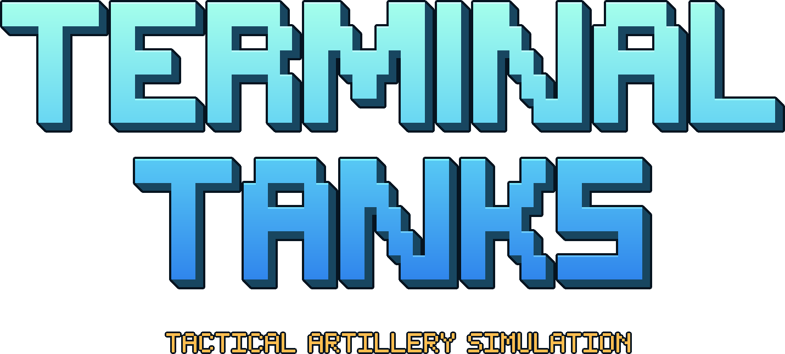

<div align="center">

<p align="center">
  
</p>

**A tactical artillery game that runs in your terminal.**<br>
Pure Python · zero dependencies · free and open source

[](https://ethanlabs101.github.io/terminaltanks-site/play.html)
[](https://github.com/ethanlabs101/TerminalTanks/releases/latest)
[](https://ethanlabs101.github.io/terminaltanks-site/)
[](https://ethanlabs101.itch.io/terminal-tanks)
[](https://youtu.be/fp_Ca-Zxc98)

[](https://www.python.org/)
[](LICENSE)

</div>

https://github.com/user-attachments/assets/3618ca75-22a8-403a-a47b-a08f9d885299

<p align="center"><a href="https://youtu.be/fp_Ca-Zxc98">Watch the launch trailer in 4K</a> · <a href="https://youtu.be/INvG4By3BBM">Story &amp; full feature trailer</a></p>

Pick a tank and an ammo, read the wind, set your angle and power, and blow the other tank off a destructible
battlefield. Everything you see and hear (pixel art, explosions, a 277-song soundtrack) is generated by pure Python at
runtime: no images, no sound files, no third-party packages.

## Quick start

```sh
git clone https://github.com/ethanlabs101/TerminalTanks.git
cd TerminalTanks
python3 terminaltanks.py
```

On Windows, run `py terminaltanks.py` in Windows Terminal. Nothing needs installing.
Don't want to install anything? **[Play it in your browser](https://ethanlabs101.github.io/terminaltanks-site/play.html)**.

## What's in the game

- **Single Player, Two Player (same keyboard) and LAN** matches, with match rules for rounds, health, wind and special ammo
- **Tournament**: 20 boss levels with their own rules (win streaks, glass cannon, Master AI finals)
- **Missions**: 50 missions in five acts: marathons, 2-vs-1, UFO hunts, co-op, boss rushes and the Mothership
- **Terminal Tickets**: ten vault bosses, each guarding a unique tank, ammo, battlefield and home screen
- **The Martyr**: a three-phase final duel, with a story
- **Collect** 123 tanks, 123 ammo types (many with real mechanics: bounce, split, cluster, burrow, homing, chain, ...),
  147 battlefields, 100 home screens and 12 animated paints, from a 314-item shop, bosses and missions
- **Workshop**: build your own tanks from parts; **Tank Studio** previews any tank on any battlefield
- **Jukebox** with an analyser and EQ, a tutorial, three save profiles and 24 cheat codes

## On the website

The [Terminal Tanks website](https://ethanlabs101.github.io/terminaltanks-site/) has more than a download page:

| | |
|---|---|
| 🎮 **[Play](https://ethanlabs101.github.io/terminaltanks-site/play.html)** | the full game in your browser, with keyboard, touch or gamepad |
| 📖 **[Catalog](https://ethanlabs101.github.io/terminaltanks-site/catalog.html)** | every tank, ammo, map, home screen, paint and boss, with a picture and how to unlock it |
| 🔧 **[Workshop](https://ethanlabs101.github.io/terminaltanks-site/workshop.html)** | mix tank parts, preview your tank in motion and save a build sheet |
| 🎵 **[Jukebox](https://ethanlabs101.github.io/terminaltanks-site/jukebox.html)** | the whole soundtrack, with a turntable, an equalizer and a live analyser |
| 💾 **[Save forge](https://ethanlabs101.github.io/terminaltanks-site/save-forge.html)** | build or edit a save file and import it into the game |
| 🔑 **[Cheat codes](https://ethanlabs101.github.io/terminaltanks-site/cheats.html)** | every code and what it unlocks |
| 🕹️ **[Terminal Tanks DS](https://ethanlabs101.github.io/terminaltanks-site/ds.html)** | the Nintendo DS port: ROM download and how to play it |
| 📜 **[About](https://ethanlabs101.github.io/terminaltanks-site/about.html)** | the story of the game and how it was built |

## Requirements

- Python 3.10 or newer
- A UTF-8 terminal with true colour, at least 96 x 28 characters (100 x 30 recommended): Windows Terminal, GNOME Terminal,
  Konsole, iTerm2, kitty, Alacritty, WezTerm and most modern terminals work. Use `--color 256` or `--color 16` on older ones.

## Controls

| Key | Action |
|---|---|
| `A` / `D` or `←` / `→` | rotate the barrel (hold `Shift` for big steps) |
| `W` / `S` or `↑` / `↓` | firing power |
| `Space` or `Enter` | fire |
| `X` | give up your turn to charge the special attack (in modes where it is on) |
| `Esc` or `P` | pause / back |
| `H` or `Tab` | change home screen (main menu) |

New to the game? The **[player's guide](docs/PLAYING.md)** covers every mode, the rules, the shop, unlocks and tips.

## Command line

```
python3 terminaltanks.py [--color {auto,truecolor,256,16}] [--seed N] [--save-file PATH]
                         [--reset-progress] [--export-music DIR [--only TEXT]] [--version]
```

| Option | What it does |
|---|---|
| `--color` | force a colour mode if colours look wrong |
| `--seed N` | seed maps and AI for reproducible matches |
| `--save-file PATH` | use another progress file |
| `--reset-progress` | delete saved progress and unlocks, then exit |
| `--export-music DIR` | render the soundtrack and every sound effect to WAV files (`--only martyr` renders a subset) |

## Saves

Progress is saved automatically to:

- Linux / macOS: `~/.config/terminaltanks/save.json` (or `$XDG_CONFIG_HOME/terminaltanks/save.json`)
- Windows: `%APPDATA%\TerminalTanks\save.json`

Set `TERMINALTANKS_SAVE` to use another file. Extra profiles live next to it (`profiles.json`, `save_profile2.json`, ...).
Saves from older versions load and upgrade automatically, and every write goes to a temporary file first, so a crash
never leaves a half-written save.

## Sound

Music and effects play through a small helper process so they can never slow the game down. It uses the `sounddevice`
or `pyaudio` package if one is installed; otherwise `paplay`, `pw-cat`, `aplay`, `play` (SoX) or `ffplay` on Linux and
macOS, and the built-in waveOut on Windows. With none of these the game simply runs silent. Rendered songs are cached
next to your save (`audio/`); `TT_AUDIO_DIR` moves the cache and `TT_NOAUDIO=1` turns sound off.

## More from Terminal Tanks

- **[Terminal Tanks on itch.io](https://ethanlabs101.itch.io/terminal-tanks)**: play in the browser or download, and tip toward the Steam release
- **[Terminal Tanks DS](https://github.com/ethanlabs101/TerminalTanks-DS)**: the Nintendo DS port
- **[Website source](https://github.com/ethanlabs101/terminaltanks-site)**: the site, catalog and browser version

## For developers

<details>
<summary>Project layout, docs and tests</summary>

```
terminaltanks.py     the entry point (terminal and browser)
tanks/
  config.py          shared constants and shell physics
  colors.py          colour maths and the interface palette
  terminal.py        terminal input/output (POSIX and Windows) and the browser terminal
  screen.py          the cell screen and the pixel canvas
  settings.py        player settings
  content/           tanks, ammo, maps, paints, home screens, songs, shop, missions, tournament, tickets, cheats, story
  art/               all drawing: tanks, shells, scenery, home-screen art, album covers, bosses
  battle/            terrain, physics, effects, AI, the tank and the special-ammo mechanics
  match/             sessions (match, mission, ticket, tournament, the Martyr), opponents, LAN data
  audio/             synthesizer, composer, mixer, sound effects, outputs and the music director
  ui/                shared widgets and the battle HUD
  scenes/            every screen of the game
  save.py            progress on disk          profiles.py   save profiles
  net.py             LAN networking            web.py        browser entry points
  app.py             the application loop and the command line
tests/               automated tests
docs/                player's guide, architecture and how to add content
```

- [docs/PLAYING.md](docs/PLAYING.md): the player's guide: modes, rules, the shop, unlocks and tips
- [docs/ARCHITECTURE.md](docs/ARCHITECTURE.md): how the code fits together
- [docs/ADDING_CONTENT.md](docs/ADDING_CONTENT.md): step-by-step recipes for new tanks, ammo, maps, home screens, songs,
  paints, shop items and cheats
- [CHANGELOG.md](CHANGELOG.md)

Run the tests with:

```sh
python3 -m unittest discover -s tests
```

They use the standard library only, run headless and only touch temporary save files.

</details>

## License

MIT. See [LICENSE](LICENSE).

   <p align="center">
     
   </p>
